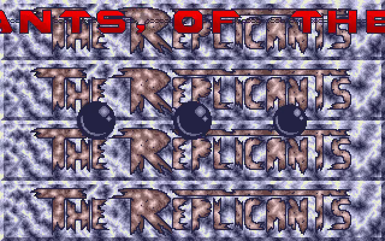
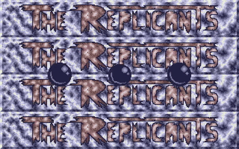

# Dom Barbarian II Go

A Go/Ebitengine port of Dom’s Atari ST cracktro for **Barbarian II**, released
by **The Replicants / The Union** in May 1989, using **DCK v1.0.14**.

Four bands reveal the metallic Replicants backdrop, with separate raster palette
transitions. Three shaded balls then descend in front of it. A red 32 × 20
pixel scroller then moves through the original 28 column profiles and vertical
bounce table. The background begins its hardware-style vertical scroll at the
native cue. Each ball changes size with one of the three YM voice volumes.

The font, backdrop, ten ball frames, encoded message, palettes and movement
tables come from the original executable. DCK provides the shared scrolling
transport and glyph rendering, tiled backgrounds, cropped sprite slots,
indexed palette lookup and YM playback. The small production controller
preserves the original cue ordering at **50 Hz** on desktop and Android.

Original production: <https://demozoo.org/productions/74492/>.

<!-- Project showcase -->
## Screenshots

[](docs/media/screenshot-1.png)

The metallic Replicants backdrop, three animated balls, and red scrolltext.

## Video

[](https://github.com/olivierh59500/go-dom-barbarian2/raw/refs/heads/main/docs/media/preview.mp4)

**[Watch or download the 24-second MP4 preview with sound](https://github.com/olivierh59500/go-dom-barbarian2/raw/refs/heads/main/docs/media/preview.mp4)**

This preview is captured from the Go production.

The animated image is silent; the MP4 includes the soundtrack.

<!-- End project showcase -->

## Desktop

```sh
go run ./cmd/dom-barbarian2
```

Escape or Space closes the intro. `-mute` disables device playback while the
balls continue following the soundtrack’s decoded voice volumes. This is a
standalone intro; it does not include or launch Barbarian II.

## Soundtrack

The replacement YM soundtrack is **Roll out 1**, by **Mad Max (Jochen Hippel)**.
Audio decoding stays inside DCK. The track starts with the main scrolling
screen and loops independently of monitor refresh. The balls retain the
native volume smoothing and ten-image selection with this soundtrack.

## Android

```sh
./scripts/run-android.sh
```

The script builds an ARM64 application, installs it on one authorized USB
Android device and launches **Dom Barbarian II**. `--build-only` produces the
APK without installing. The host uses the existing SDK 36 / NDK 28.2 / Java 17
configuration, landscape display, immersive mode and screen wakefulness.

## Verification

```sh
go test ./...
go vet ./...
go test -tags dck_gpu_rendercheck ./internal/demo
go run ./cmd/dom-barbarian2 -capture captures -frame 3200 -mute
```

An independent 68000 execution fixture checks 5,000 controller frames, including
profile changes, the delayed background cue and voice smoothing. Twenty-nine
complete indexed frames match the original graphics routines pixel for pixel,
including the hardware-scroll wrap scanline. Palette-band rendering is checked
in a live Ebitengine graphics context. Controller updates do not allocate.

## Video

```sh
go run ./cmd/video
```

DCK records only the demo canvas and its own audio. The default export is a
three-minute, 50 fps H.264/AAC MP4 at 640 × 400, with a PNG poster and JSON
report in `recordings/`. `-duration` and `-poster-at` change the recording
length and poster frame. The MP4 can also be converted to VP9/Opus WebM.

## Asset extraction

```sh
go run ./cmd/extract -input /path/to/unpacked-memory.bin -assets /path/to/export
```

Extraction exports artwork and authored tables from an unpacked native memory
image. The runtime contains Go code and data assets; it does not embed or
execute the original program. References, captures, recordings and build
products remain local and are excluded from Git.
